  
  <!-- TODO: add your LinkedIn URL and remove this comment -->
  <!--  -->

## 👋 About me

- 💼 Full-stack developer at **Lumora Technologies**
- ⚙️ Java & Spring Boot on the back, TypeScript & Next.js on the front, Postgres underneath
- 🤖 Exploring AI tooling: Word add-ins, content platforms and multi-agent coding apps

## 🛠️ Tech stack

   
   
  

## 🚀 Featured projects

<b>🧾 Lumora POS — offline-first restaurant point of sale</b>

 

Desktop POS that keeps selling when the internet drops. The local database is the source of truth for every sale, and data syncs to the cloud when online.

[Repo →](https://github.com/lahiru321/POS-desktop-restaurant)

<b>🧩 Vcode — run multiple AI coding CLIs side by side</b>

 

Desktop app for running and managing Claude Code, Gemini CLI and Codex CLI in one window.

[Repo →](https://github.com/lahiru321/Vcode)

<b>📊 Weekly Report Generator — team reports and dashboard</b>

 

Team members submit weekly reports, managers approve or send them back, and a dashboard charts the whole team.

[Repo →](https://github.com/lahiru321/weekly-report-generator)

<b>✍️ Word Polish — AI add-in for Microsoft Word</b>

 

Select text in Word and turn it into clear, professional writing with OpenAI.

[Repo →](https://github.com/lahiru321/word-polish)

<b>🌾 Crop Yield Model — machine learning prediction</b>

 

Model that predicts crop yield from historical yield data.

[Repo →](https://github.com/lahiru321/CropYieldModel)

## 📈 GitHub stats

  
  

  

## 🐍 Contribution snake

  <picture>
    <source media="(prefers-color-scheme: dark)" srcset="https://raw.githubusercontent.com/lahiru321/lahiru321/output/github-snake-dark.svg" />
    <source media="(prefers-color-scheme: light)" srcset="https://raw.githubusercontent.com/lahiru321/lahiru321/output/github-snake.svg" />
    
  </picture>

  

